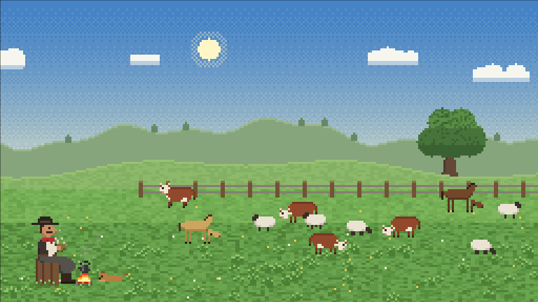
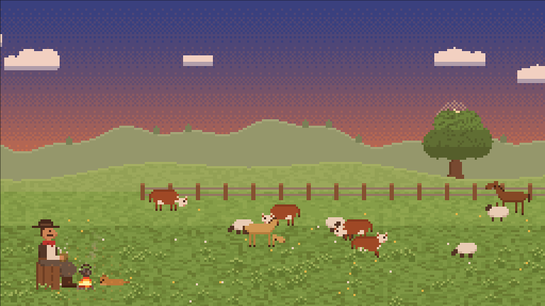
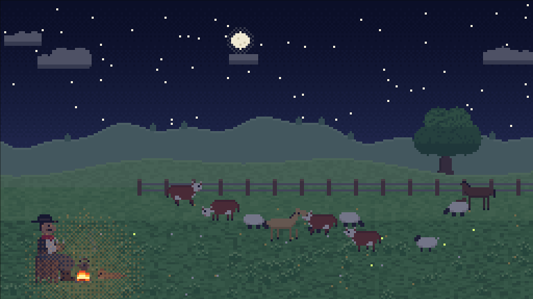

# PlayMate · Mate no Pampa

*Bebendo um mate.*

A pixel-art scene from Rio Grande do Sul: a gaúcho sits on a tree stump by the *fogo de chão*, serves himself chimarrão from the kettle and sips it slowly while cattle, horses and sheep graze on the *coxilha*. The day turns into night, quero-queros cross the sky, and an original 8-bit milonga plays in the background.

**▶ [Open the scene](https://digomes87.github.io/PlayMate/)**



| Entardecer | Noite |
|---|---|
|  |  |

## In the scene

| | |
|---|---|
| **O gaúcho** | Hat, red *lenço*, vest, *bombacha*, boots with spurs. Every round he lifts the *chaleira* off the fire, pours water over the *cuia* and drinks it in two sips, eyes closed. The page counts the *cuias cevadas*. |
| **Fogo de chão** | Flickering fire on a ring of stones, smoke drifting with the wind, steam from the kettle spout and the cuia. A *cusco* sleeps beside it and wags its tail now and then. |
| **A coxilha** | Hereford cattle, a dark and a bay criollo horse and a few sheep wander, stop to graze and turn back at the edges of the field. An *umbu* stands alone on the hill. |
| **O céu** | A full day in two minutes: dawn, midday, sunset, a moonlit night with stars, then dawn again. Fireflies come out at night and the fire lights everything around it. |
| **A trilha** | An original milonga in A minor, 2/4, with the bass in the 3-3-2 milonga rhythm. It is synthesised live in the browser (square-wave lead, triangle bass, pulse-wave chords, noise percussion), so no audio file is downloaded. |

### Controls

- **Amanhecer / Meio-dia / Entardecer / Noite** freeze the sky at that time; **Ciclo do dia** lets it run.
- **Pausar** stops the animation.
- **♪ Tocar milonga** starts the soundtrack. Browsers only allow sound after a click, so it never starts on its own; it pauses while the tab is hidden and resumes when you come back.

With *reduce motion* enabled in the operating system, the scene opens paused.

## Run it locally

No build step and no dependencies: plain HTML, CSS and JavaScript modules.

```bash
npm start      # serves site/ at http://localhost:8000
npm test       # unit tests (Node 22+, node:test)
```

ES modules do not load from `file://`, so open the page through the local server.

## How it works

The scene is drawn on a 256 × 144 canvas and scaled up with `image-rendering: pixelated`, so every pixel stays crisp.

- **Sprites** are written as text grids, one character per pixel, and cached as small canvases.
- **The sky** is a banded gradient with ordered (Bayer) dithering; its colours, and a tint over the ground, follow keyframes along the day.
- **The ground layer** (landscape, herd, gaúcho, particles) is drawn on its own canvas so the time-of-day tint affects the field but not the sky. The fire and its glow are drawn afterwards so they stay bright at night.
- **The ritual** (rest, reach for the kettle, pour, sip…) is a timeline of poses; arm and kettle positions are interpolated pixel by pixel.
- **The music** is a score of 16 bars on a sixteenth-note grid, scheduled slightly ahead of the Web Audio clock for steady timing.

```
site/
├── index.html
├── styles/main.css
└── scripts/
    ├── main.js            render loop, controls
    ├── pixel-math.js      dithering, colour, seeded random
    ├── sprite.js          sprite grids, pixel drawing
    ├── light.js           sky colours along the day
    ├── sky.js             sky, sun, moon, stars, clouds
    ├── landscape.js       hills, field, umbu, fence, grass
    ├── herd.js            cattle, horses, sheep
    ├── ritual.js          the mate timeline and poses
    ├── camp.js            gaúcho, kettle, fire, dog
    ├── particles.js       smoke and steam
    ├── ambient.js         quero-queros, fireflies
    └── music/
        ├── score.js       the milonga
        ├── instruments.js Web Audio voices
        ├── player.js      look-ahead scheduler
        └── audio-session.js  sound on iPhone with the silent switch on
```

The tests in `tests/` cover the logic that does not need a browser: the ritual timeline, the light along the day, the pixel maths, the score and the silent WAV used on iOS.

## Delivery

Every push to a work branch (`feature/`, `fix/`, `chore/`, `docs/`, …) goes to GitHub Pages without manual steps:

```
work branch ──▶ PR + tests ──▶ develop ──▶ tests ──▶ main ──▶ GitHub Pages
               deliver.yml               promote.yml        deploy.yml
```

Nothing reaches `main` without green tests, and only the pipeline can update it. Details, branch rules and the one-time repository setup are in [docs/branching.md](docs/branching.md).
